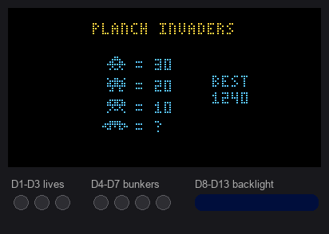
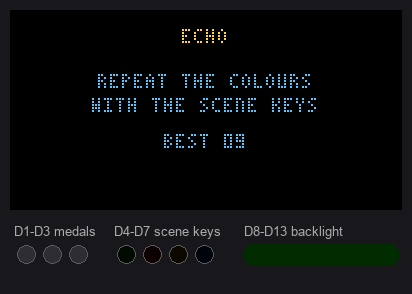
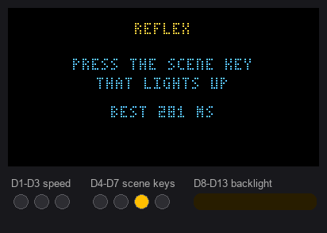
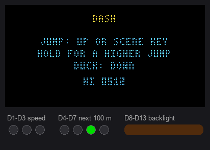

# PlancH Arcade

The firmware hides four small games. They use the display, the keys and all 13 LEDs, and they
keep one best score each in the panel's memory. Nothing to install: they come with the firmware.
The best scores are also sensors in Home Assistant: **Invaders best**, **Echo best**,
**Reflex best** and **Dash best** on the panel's device page.

## Open and leave

- **Open**: hold **OK** and **Back** together for 3 seconds. The first of the two keys still does
  its job in the menu, so press Back first, then OK.
- **Choose**: Up and Down move in the list, OK starts the game. Each game shows its best score.
- **Pause**: a short press of Back during a game; OK resumes. On a title or game over screen a
  short Back goes back to the list.
- **Leave**: hold Back for 3 seconds anywhere (a bar fills the top of the display), or leave the
  panel alone for a minute outside a game. The panel goes back to the Home Assistant menu.

While the arcade is open the keys do not control Home Assistant. Only the real board can open it:
the [test bench](test-bench.md) does not report key releases.

## The games

### PlancH Invaders

Rows of invaders march down; stop them with the cannon.

- **Keys**: Left and Right move the cannon, **Scene 4** (the bottom scene key) fires, OK starts.
- **LEDs**: D1–D3 the lives, D4–D7 the four bunkers (green to red as they crumble), the backlight
  takes the colour of the wave and flashes on every hit.

### Echo

A memory game. Each scene key has its colour: S1 green, S2 red, S3 yellow, S4 blue. The panel
plays a sequence on the LEDs D4–D7 and on the display; repeat it with the scene keys. Every round
adds a step and plays faster; a mistake or 5 seconds without keys ends the game.

- **Score**: the rounds you passed. D1–D3 light up as medals every 5 rounds.

### Reflex

A reaction game of 10 rounds. After a random wait one scene key lights up: press it as fast as
you can.

- **Mistakes**: a key during the wait shows "TOO SOON" and the round starts again; a wrong key,
  or no key within 1 second, counts 1000 ms.
- **Score**: the average time of the 10 rounds, in milliseconds; the best is the lowest.
- **LEDs**: D1–D3 how fast the last round was (3 under 250 ms, 2 under 350, 1 under 500), the
  backlight green, yellow or orange by speed, red on mistakes.
- The time includes the small delay of the panel (a few tens of milliseconds), the same for
  everyone: good for a challenge, not a lab measurement.

### Dash

An endless runner. The runner goes by itself and gets faster and faster; one hit ends the run.

- **Keys**: Up, OK or any scene key jump (hold for a higher jump); Down ducks, and in the air
  makes the runner come down faster.
- **Obstacles**: crates and posts from the start, holes in the ground from 150 m, birds from
  300 m (duck under the high ones, jump over the low ones).
- **Score**: the metres run.
- **LEDs**: D1–D3 the speed level (green, yellow, red), D4–D7 the progress to the next 100 m (all
  white at every hundred), the backlight orange by day and blue by night, changing every 500 m.

The previews are recorded from the same code running on a PC, with an automatic player.
